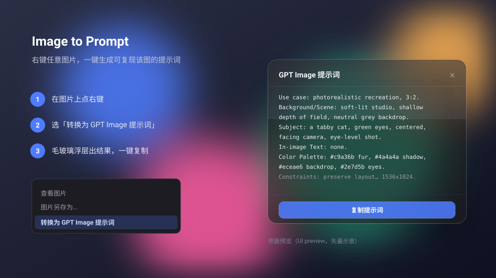

# Image → GPT Image Prompt

[](LICENSE)


为创作者和 AI 工作流打造的**本地优先**图像反推扩展——右键任意图片，即得可复现它的 **GPT Image** 提示词。

_Local-first image-to-prompt for GPT Image._



> 上图为界面示意（UI preview）。

## 工作原理

```
右键图片 → contextMenus → background 抓图转 base64
   → 直接调视觉模型（AiHubMix / 任意 OpenAI 兼容网关，用户自带 Key）
   → 返回结构化复现提示词 → 毛玻璃浮层展示 + 一键复制
```

**无后端架构**：API Key 由用户自带，仅存在浏览器本地（`chrome.storage.local`），不上传任何第三方服务器，也不需要部署任何服务。

## 安装与使用

1. **下载/克隆**本仓库。
2. **装扩展**：Chrome → `chrome://extensions` → 开启「开发者模式」→「加载已解压的扩展程序」→ 选 `extension/` 目录。
3. **填 Key**：点工具栏的扩展图标（藏在 🧩 拼图菜单里，可固定到工具栏）→ 弹窗里填入你的 AiHubMix / OpenAI Key → 保存。
4. **使用**：任意网页图片上右键 →「转换为 GPT Image 提示词」→ 毛玻璃浮层出结果 → 复制 → 丢进 GPT Image。

## 结构

```
extension/                Chrome 扩展（MV3，无需构建，直接加载）
  manifest.json
  background.js           右键菜单 + 抓图 + 直接调视觉模型 + 元提示词
  content/overlay.{js,css}  毛玻璃结果浮层 + 复制
  popup.html / popup.js     工具栏弹窗：快速填 Key
  options.html / options.js 完整设置：Key / 模型 / API 地址
backend/                  可选后端代理（自带 Key 时用不到，留作备用）
store/                    商店上架材料（文案、隐私政策）
docs/preview.svg          界面预览图
```

## 视觉模型

默认 `gpt-5.5`（与 GPT Image 同生态，提示词迁移损耗最小）。
通过 AiHubMix 网关调用，可在设置里换成 `claude-opus-4-8`、`gemini-3.1-pro` 等任意网关支持的模型对比效果。

## 关于「一模一样」的现实预期

纯文字（prompt-only）路线**无法 100% 复现原图**——文生图是有损、非确定过程。
本扩展已按 OpenAI 官方提示词规则把单次提示词写到信息密度最大（字段顺序、画面文字逐字锁定、HEX 色板、精确长宽比），
构图与主体可高度接近；但精确人脸、复杂画面文字、繁多细节仍会有偏差。
若要逼近「几乎一致」，需改用 `images.edit` 参考图重绘模式（当前未启用，按需扩展）。

## License

[MIT](LICENSE) © 2026 realruian
